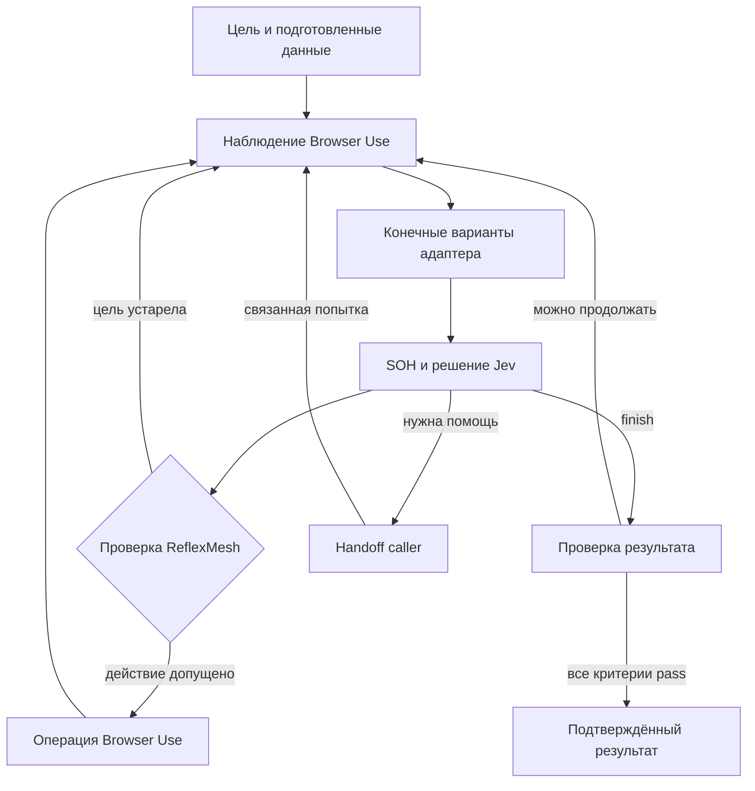

# Спецификация браузерного ядра ReflexMesh

**Версия спецификации:** 0.1. **Дата:** 11 октября 2026. **Целевой инкремент:** V0.6 Browser Core, основа браузерного MVP V1.0. **Статус:** согласованный архитектурный выбор, требования к реализации. Номер инкремента не меняет текущую версию пакета автоматически.

ReflexMesh выполняет ограниченную браузерную задачу на заранее неизвестном сайте. Вызывающий агент задаёт цель, данные, разрешения и критерии результата. SystemOneHarness организует цикл решений, Jev выбирает следующий шаг, Browser Use наблюдает страницу и исполняет операции. ReflexMesh допускает каждое действие, управляет бюджетом и подтверждает результат по свидетельствам. Когда имеющихся действий или данных недостаточно, управление возвращается вызывающему агенту с возможностью продолжить в той же сессии.

В первую реализацию берём **SystemOneHarness + Browser Use + Jev**, а генерацию текста и сложные решения оставляем LLM вызывающего агента. Полный jev-ultrafast в зависимости ядра не включаем. Из его подхода используем компактное наблюдение, проверку актуальности цели, немедленную запись исхода действия и остановку при отсутствии прогресса.

Слова «должен» и «запрещено» ниже задают обязательное поведение новой реализации. Спецификация не означает, что общий браузерный адаптер, handoff или указанные интерфейсы уже реализованы.

## 1 Прикладной сценарий

Caller передаёт задачу: «На этом сайте найди заказ №125, добавь заметку “Перезвонить завтра” и сохрани её». Он заранее подготавливает номер заказа и текст заметки, разрешает необходимые операции и указывает, как проверить результат.

Ядро открывает сайт, обнаруживает доступные элементы и предлагает Jev конечные варианты следующего шага. Jev последовательно выбирает раздел заказов, поле поиска, подготовленное значение, результат поиска, поле заметки и сохранение. После каждого действия ядро получает новое наблюдение. Если нужно придумать текст, выбрать между неоднозначными заказами или разобраться с неподдерживаемым виджетом, оно возвращает задачу caller.

Нажатие «Сохранить» ещё не завершает задачу. Проверка должна связать заметку с нужным заказом и подтвердить заявленный уровень сохранения. Если доступна только надпись «Сохранено», результат остаётся неподтверждённым для критерия постоянного сохранения.

## 2 Выбранные инструменты

| Компонент | Решение для первой реализации | Как применяем |
| --- | --- | --- |
| ReflexMesh | Сохраняем существующее Python ядро | Контракты, admission, владельцы сессий, бюджеты, результаты и verifier |
| SystemOneHarness | Commit `ab8e8f08b4a6268c0633a474423d556599ee06a4` | Controller, конечное пространство действий, компиляция вопросов, provider и история цикла |
| Browser Use | `0.13.10`, commit `5c892e013a73e6622e6f50336e1eb0aa2c4405f2` | BrowserSession и низкоуровневые операции; автономный LLM Agent не запускаем |
| Jev | Провайдер выбирается явно: TypeSafe или OpenRouter | Один запрос решений на обычный шаг; сохраняем запрошенную модель и фактически обслужившую модель |
| LLM caller | Уже используемый вызывающий агент | Подготовка значений, разрешение неоднозначности, помощь с недоступным для Jev действием |
| jev-ultrafast | Источник отдельных приёмов и кандидат для сравнения | Не подключаем его отдельный browser driver и второй цикл выполнения |
| OpenJev 4B v0.2 | Первый кандидат для последующего локального сравнения | Подключаем через сменный decision provider после рабочего основного пути |
| Playwright MCP, Stagehand, OmniParser | За пределами первого инкремента | Добавляем при воспроизводимом дефиците текущего наблюдения или исполнения |

Браузерный инкремент работает на Linux или WSL с Chromium. Зависимости устанавливаются как отдельная браузерная возможность; базовая маршрутизация без них сохраняется. Установка фиксирует commit, версии транзитивных зависимостей и браузера. Обновление Browser Use требует повторного прохождения контрактных проверок адаптера.

Для известного единственного исполнителя `browser.soh` отдельный вызов JevRouter на каждую задачу не нужен. Браузерный вход сразу выбирает этот исполнитель после preflight. Существующий routing API продолжает работать отдельно.

## 3 Роли и право принимать решения

| Роль | Принимает решения | Передаёт дальше |
| --- | --- | --- |
| Пользователь | Цель и допустимые действия | Задачу и существенные ограничения caller |
| Caller LLM | Разбиение на подзадачи, значения, критерии; решение после handoff | BrowserTask или запрос продолжения |
| Jev | Следующая операция, текущая цель операции, версия подготовленного значения; finish или escalate | Предложение из текущего набора |
| SystemOneHarness | Организация шага и применение порогов модельных оценок | Предложение и объясняющие его оценки |
| Browser adapter | Что сейчас наблюдаемо и исполнимо; актуальна ли выбранная цель | Observation, конечные варианты, результат драйвера |
| ReflexMesh runtime | Допуск действия, бюджет, отмена, владение, передача управления | Разрешённую подготовленную команду или отказ |
| Verifier | Выполнен ли каждый критерий на подходящих свидетельствах | pass, fail или unknown с доказательством |

Jev и LLM не меняют разрешения, критерии, лимиты или содержимое принятой версии TextSlot. Browser Use не объявляет исходную задачу успешной. Upstream `completed`, `finish_insisted` и `environment_terminal` трактуются как сигналы к проверке.



Схема показывает обычный ход. Отмена, исчерпание бюджета, ошибка протокола и неизвестный эффект останавливают выполнение по правилам ниже.

## 4 Область первой реализации

Обязательны неизвестные заранее сайты с DOM интерфейсом: ссылки, кнопки, текстовые поля, обычные select, доступные checkbox и radio, поиск, формы, динамическое изменение элементов и несколько вкладок. Общий адаптер не использует `data-reflex-id`, известные пути fixture или сценарии конкретных сайтов.

Iframe и shadow DOM включаются только в объёме, подтверждённом интеграционными пробами на выбранной версии Browser Use. Возможности объявления `frames`, `cross_origin_frames` и `open_shadow_dom` проверяются отдельно. Недоступный frame или непрозрачный виджет даёт явную причину handoff. Для закрытого shadow DOM, canvas, CAPTCHA, загрузки файлов, сложного drag and drop и произвольных keyboard widgets прямой путь V0.6 не обещается.

Preflight возвращает обнаруженные возможности. Установленный пакет сам по себе не означает поддержку операции. Если задача требует недоступной возможности, ядро возвращает handoff либо `blocked/executor_unavailable` до соответствующего действия.

Ядро запускает управляемую сессию и сохраняет её между связанными попытками до завершения задачи, отмены или истечения lease. Подключение к произвольному личному браузеру пользователя и восстановление сессии после перезапуска процесса относятся к следующим инкрементам. Изоляция владения относится к исполнителям, управляемым ReflexMesh; исключительность против любых внешних CDP клиентов не заявляется.

## 5 Входной контракт задачи

Новый контракт называется `browser-task/0.1`. Он существует рядом с fixture контрактом `execution-task/0.1`; текущий CLI и его результаты сохраняют прежнюю семантику. Поле `fixture` в новом контракте отсутствует.

| Поле | Требование |
| --- | --- |
| task_id, revision | Непустой идентификатор и положительная ревизия |
| goal | Конкретная ограниченная цель |
| start_url | Абсолютный HTTP или HTTPS URL без встроенных credentials |
| allowed_origins | Непустой набор разрешённых origins верхнего уровня и вкладок |
| permissions | Разрешённые примитивные операции из раздела 7 |
| constraints | Дополнительные ограничения выполнения через зарегистрированные predicates; пустой массив допустим |
| text_slots | Неизменяемые объекты id, version, value; sensitivity равна normal или secret |
| criteria | Непустой набор поддерживаемых постусловий из раздела 11 |
| limits | Конечные общие лимиты из раздела 12 |

Provider, модель, ключи, версия адаптера, политика редактирования логов и доступные verifier plugins задаются конфигурацией сервиса. Страница и task не могут подменить эту конфигурацию. Caller получает её идентификатор и фактические значения в результате.

Пример контракта для поиска и извлечения цены:

```json
{
  "schema_version": "browser-task/0.1",
  "task_id": "product-price-001",
  "revision": 1,
  "goal": "Найти товар с точным названием Widget A и вернуть видимую цену из его карточки.",
  "start_url": "https://shop.example/catalog",
  "allowed_origins": ["https://shop.example"],
  "permissions": ["navigate", "click", "type_text", "scroll", "go_back", "switch_tab", "wait"],
  "constraints": [],
  "text_slots": [
    {"id": "product", "version": 1, "value": "Widget A", "sensitivity": "normal"}
  ],
  "criteria": [
    {
      "id": "price_found",
      "predicate": "scoped_extract",
      "args": {
        "anchor_slot_ref": "product@1",
        "field_name": "Цена",
        "output_key": "price"
      }
    }
  ],
  "limits": {
    "wall_seconds": 120,
    "max_steps": 64,
    "max_model_calls": 96,
    "max_action_retries": 0,
    "max_handoffs": 3
  }
}
```

Значения лимитов в примере — базовая конфигурация V0.6. Для другой задачи caller может задать иные конечные положительные лимиты. Нулевой бюджет повторов обязателен в первой реализации. Unlimited режим старого fixture CLI не переносится в новый BrowserTask.

Вход ограничен 64 KiB UTF 8; goal — 10 000 символов; идентификаторы — 128 символов. Отклоняются дубликаты JSON ключей, лишние поля, неверные типы, нечисловые и бесконечные лимиты, неоднозначные origins, повторные id и отсутствующие ссылки слотов. Схема неизвестного критерия даёт `blocked/unsupported_criterion`; неверная структура входа — `invalid_input` без начала попытки.

`allowed_origins` ограничивает управляемую навигацию и выбор вкладок. Это не сетевой sandbox для ресурсов страницы. Разрешение `click` допускает взаимодействие с элементами и может приводить к внешним изменениям. Оно не означает доказанное бизнес разрешение «можно всё, кроме покупки». Если caller требует конкретного запрета, который общий адаптер не способен обеспечить кодом, задача блокируется как `unsupported_constraint` или получает отдельный доверенный policy plugin. Оценка Jev и текст на кнопке не заменяют такое ограничение.

## 6 Наблюдение и конечные варианты

Browser Use остаётся источником DOM состояния и операций. ReflexMesh добавляет метаданные идентичности и проверки, необходимые для INV 05. Собственную универсальную систему обнаружения элементов с нуля не строим.

| Объект | Обязательные данные |
| --- | --- |
| Observation | session_id, observation_id, captured_at, текущая вкладка и URL, доступные вкладки и frames, видимый текст, состояние загрузки, coverage и причины усечения |
| Target | Непрозрачный target_ref, session/tab/frame identity, document generation и node identity, role, accessible name, тип, enabled/visible, текущие значения с редактированием секретов, контекст контейнера |
| Action option | option_ref, observation_id, операция, цель или составная цель, неизменяемые параметры, policy_revision |
| Proposal | Идентичность задачи и попытки, observation_id, операция, ссылки выбранных вариантов, модельные оценки |
| Prepared command | Проверенные фактические аргументы драйвера, action_id, owner_epoch и разрешённый контекст |

DOM index используется только как временный транспортный аргумент Browser Use. Совпадение индекса, CSS id или надписи после обновления страницы не доказывает тождественность элемента. После смены документа, frame, вкладки или замены узла старые ссылки недействительны. Если драйвер не позволяет подтвердить идентичность цели, её повторное использование запрещено.

Адаптер строит отдельные конечные списки для кликов, полей, версий TextSlot, опций select, клавиш и вкладок. Опция select привязывается одновременно к select и конкретному option, поэтому ответы Jev не могут случайно соединить разные dropdown. Разрешённые пары «поле и слот» проверяются кодом после выбора. Если между ними есть обязательная зависимость, применяется составной вариант, а не декартово произведение.

Вопрос содержит не более 255 вариантов с учётом служебных значений. Наблюдение обычного шага ограничивается 200 элементами и 8 000 символами видимого текста. Адаптер обязательно сообщает `coverage=partial`, количество пропущенных вариантов и способ получения следующего окна. Нельзя молча потерять элемент и объявить, что действий больше нет.

Для плотной страницы V0.6 использует видимое окно, прокрутку и перечень контекстных групп. `focus_region` меняет только область представления наблюдения и расходует шаг без браузерного клика. Если группировка или полнота недоступны, возвращается `observation_incomplete`. Произвольный LLM ranking и новый perception сервис на каждом шаге не добавляются.

Default наблюдение содержит цель, подготовленные значения normal, текущие элементы и последние три шага. Значения secret не отправляются decision provider: Jev получает только описание назначения и ссылку. Provider payload и постоянная redacted trace — разные представления; допустимые для модели значения не становятся автоматически допустимыми для логов.

## 7 Действия и запрос к Jev

| Операция | Конечные аргументы | Условия |
| --- | --- | --- |
| navigate | URL из start_url или наблюдаемой разрешённой ссылки | Origin допущен; произвольный URL от Jev не принимается |
| click | Текущий click target_ref | Одна однозначная доступная цель |
| type_text | field_ref и slot_ref | Точное значение принятой версии; замена текущего содержимого |
| select_option | Составной option_ref | Связанные select и option актуальны |
| press_key | focus_ref и key | Проверенный фокус; Enter, Escape, Tab и Arrow keys из allowlist |
| scroll | Контекст прокрутки и направление up или down | Ограниченное перемещение на одно окно |
| go_back | Текущая вкладка | Известный разрешённый destination; иначе handoff |
| switch_tab | Текущий tab_ref | Вкладка принадлежит управляемой сессии и разрешённому origin |
| wait | Фиксированная пауза 1 секунда | Пауза расходует общий deadline |
| focus_region | Текущий region_ref | Изменение представления без внешнего действия |
| finish | Без аргументов | Только запрос проверки результата |
| escalate | Без аргументов | Возврат caller |

`focus_region`, `finish` и `escalate` являются управляющими операциями и не добавляются в permissions браузера. `hold_key`, выполнение JavaScript, произвольные selectors, shell команды и координатные действия в V0.6 не доступны Jev. Безопасные внутренние скрипты наблюдения адаптера относятся к доверенному коду зависимости.

Один обычный шаг отправляет в SOH один набор typed questions: следующая операция, необходимые параметры конечных списков, `goal_reached` и предусмотренные guards. Параметры не требуют отдельных сетевых запросов. Ответ на вопрос о невыбранной операции не даёт права исполнять её.

Provider wrapper валидирует типы, конечность чисел, диапазоны и принадлежность каждой выбранной ссылки исходному набору. Неизвестная операция, цель или изменённый параметр даёт `failed/protocol_error`; безопасного исполнения «по догадке» нет.

Начальная конфигурация порогов соответствует pinned SOH: read `0.5`, write `0.7`, destructive `0.9`, finish `0.5`. Read используются для observe control, scroll, switch_tab, wait и focus_region; взаимодействия с возможным эффектом получают write. Destructive операции отдельно не рекламируются в V0.6. Эти пороги управляют отказом при слабой оценке, а не разрешением действия и не доказательством его успешности.

Для выбранной операции SOH оценивает самый слабый из необходимых judgments. В trace сохраняются исходные `confidence`, выбранные значения из distribution и семантика provider. Они не перемножаются в «вероятность успеха». Смена provider или модели требует отдельной конфигурации и эксперимента: одинаковые имена полей не гарантируют одинаковой шкалы.

Применение порогов не заменяет admission. Даже максимальная оценка не допускает устаревшую цель, неизвестный слот, запрещённый origin, истёкший budget или действие после принятой отмены.

## 8 Цикл и admission

1. Runtime валидирует task, готовит trace и общий бюджет, проверяет поддержку критериев и требуемых ограничений, создаёт сессию и владельца.
2. Начальная навигация проходит тот же dispatch gate, расходует шаг и требует navigate permission. После неё снимается baseline и проверяется already_satisfied.
3. SOH начинает цикл. Runtime резервирует шаг до observe и модельный вызов до обращения к Jev. Адаптер получает наблюдение и конечные варианты, отфильтрованные по текущей политике.
4. SOH принимает решение. Runtime связывает его с исходным observation и повторно проверяет выбранные ссылки, операцию и неизменяемые параметры.
5. Адаптер revalidate подтверждает session, tab, frame, document/node identity, доступность, значимые атрибуты, фокус для клавиши, разрешённый origin и актуальную версию слота.
6. Под коротким общим gate runtime повторно проверяет owner_epoch, policy_revision, терминальное состояние, deadline и резервы. Он атомарно записывает `dispatch_committed(action_id)` и единственную in flight команду.
7. Подготовленная команда немедленно передаётся Browser Use. Между commit и вызовом драйвера нет очереди, нового решения или повторного поиска значения.
8. Возврат драйвера или его ошибка записываются до следующего observe. Получается свежее состояние; эффекты и критерии обновляются, затем начинается следующий шаг.

В одном цикле выполняется не более одной браузерной команды. Gate не держится во время сетевого запроса, IPC, драйвера или ожидания. Действие учитывается по логическому порядку dispatch и cancel, а не по моменту поступления HTTP запроса на сайт.

При устаревшей цели выполняется свежий observe и новое решение под тем же бюджетом. Нельзя автоматически заменить цель элементом с похожей надписью. Три последовательных отказа из-за stale состояния дают `needs_handoff/stale_loop`. Нарушение разрешения останавливает как `blocked/policy_denied`. Unsupported проверка идентичности даёт `needs_handoff/adapter_contract_unsupported` до dispatch.

Одинаковое действие в одинаковом существенном состоянии не повторяется. Существенное состояние включает URL, выбранный контекст, доступные цели и значения; новые timestamps и observation_id не считаются прогрессом. После трёх циклов без нового состояния, эффекта или движения к критерию выполняется `needs_handoff/no_progress`. Пока страница подтверждённо загружается, ожидание ограничивается её timeout и общим deadline.

Ошибки протокола и runtime не маскируются переключением на другую модель. Они дают failed с диагностикой. Корректный отказ модели, неподходящие варианты и недостающие данные могут давать handoff.

Если SOH закончился по finish, но свежее постусловие ещё fail и есть допустимый следующий шаг, runtime запускает следующий SOH segment в той же попытке, без reset браузера, с сохранённой историей и общими резервами. Нового автономного цикла не возникает. Три безрезультатных finish дают handoff/no_progress. Unknown при отсутствии доступного способа проверки даёт verification_unknown. Segment не может обойти терминальный gate или начать действие после принятой остановки.

## 9 Текст и неизвестные эффекты

Caller передаёт готовые TextSlots. Jev выбирает `id@version` и поле; runtime создаёт приватную неизменяемую команду с точным значением. Передача аргумента драйверу фиксируется отдельно от состояния DOM и сервера. Существующий контролируемый text dispatch сохраняется как основа; доступ к приватным объектам зависимости локализуется и проверяется на pinned версии.

Новые тексты после handoff принимаются в новой ревизии задачи и связанной попытке. Принятый snapshot предыдущей попытки не редактируется. Старые ссылки не перенаправляются на новую версию. Если изменилось только содержание слота, цель и критерии сохраняются; изменённые критерии явно принимаются как новая ревизия и не переписывают старую историю.

Каждое действие имеет независимые поля `driver_outcome` и `effect`. Возврат драйвера может быть returned или error, эффект — applied, not_applied или unknown. Успешный click не доказывает запись на сервере. Ошибка ответа после click не доказывает отсутствие записи.

Произвольный click, Enter, type_text или select может запускать сайт с внешним эффектом, включая autosave. При потере подтверждения такой эффект считается unknown. Следующие изменяющие действия блокируются до reconciliation. Разрешены свежие наблюдения и предусмотренные проверки, не повторяющие потенциально применённое действие. Отсутствие результата в ещё не обновлённом UI не доказывает not_applied.

В V0.6 автоматические повторы browser команд отключены. Это правило применяется и к повтору, вновь предложенному Jev или LLM. Одинаковая операция с неизвестным эффектом не становится новой операцией из-за нового action_id, observation_id, owner или handoff. Регистр эффектов ведётся на всю цепочку задачи. Exactly once для внешнего сайта не обещается.

Повторы внутри browser backend, способные снова отправить click, input или submit, должны быть отключены либо покрыты проверяемым механизмом дедупликации. Доказательство одного вызова Tools.act само по себе не доказывает отсутствия внутренних повторов. Неподдерживаемая обязательная проверка даёт adapter_contract_unsupported и не закрывает runtime.no_uncertain_repeats.

## 10 Handoff и продолжение

Handoff обязателен как часть первого рабочего инкремента. Он не реализуется вторым автономным браузерным агентом внутри ReflexMesh.

| Причина | Что может сделать caller |
| --- | --- |
| missing_value | Подготовить новый TextSlot и новую ревизию |
| ambiguous_target | Уточнить выбор, предоставить связанные с наблюдением конечные варианты или вернуть вопрос пользователю |
| no_confident_action, no_progress, stale_loop | Выбрать один ограниченный шаг или передать уточнённую цель в новой ревизии |
| unsupported_widget, observation_incomplete | Использовать доступное наблюдение, включая временный screenshot, или остановить задачу |
| verification_unknown | Получить дополнительные допустимые свидетельства; не снижать критерий ради completed |
| effect_unknown | Сначала установить исход предыдущего действия; не повторять его |

Пакет содержит task_id и revision, attempt_id, parent chain, причину, последнее observation_ref, текущий URL и вкладку, доступные действия, совершённые операции и их эффекты, нерешённые эффекты, оценки criteria, permissions, owner state, оставшиеся общие лимиты и одноразовый continuation token с expiry.

Попытка, запросившая handoff, терминально заканчивается как `incomplete/needs_handoff`. Старый исполнитель теряет право dispatch. Продолжение создаёт **новую связанную попытку** в той же browser session с новым owner_epoch и свежим observation. Терминальное состояние старой попытки не изменяется. Возможность сохранения сессии не отменяет правила её карантина.

Передача права на действия допускается только после разрешения конфликта с in flight командой. Неизвестный существенный эффект или неизвестный cleanup не дают права передать сессию для новых mutations. При истечении lease сессия закрывается либо карантинируется и token становится недействительным. Начальный lease — 60 секунд, но не позднее общего task deadline; время ожидания caller входит в wall budget.

Caller может продолжить в одном из двух режимов:

- **Return to Jev:** принимает новую ревизию с данными и запускает обычный цикл.
- **LLM assistance:** подаёт по одному предложению из свежих конечных вариантов, максимум пять шагов на handoff; после каждого действует общий gate, снимается новое наблюдение. Далее управление возвращается Jev либо результат снова передаётся caller.

При начале LLM assistance новая попытка остаётся активной и выдаёт BrowserProgress со свежим наблюдением. Подача одного действия и ожидание следующего предложения не являются терминальными handoff и не увеличивают max_handoffs. Progress всегда содержит новый одноразовый token. Выход из assistance к Jev закрывает эту попытку с handoff и начинает связанную Jev попытку; этот переход расходует общий handoff budget.

В обоих режимах сохраняются task chain, бюджет, permissions, регистр эффектов и обязательные ограничения. Continuation token связан с цепочкой, session, scope и owner_epoch; повторное или чужое использование отклоняется. Локальная передача не требует доступности cloud LLM: если caller не умеет продолжать, он получает полный handoff и неподтверждённый итог.

Визуальная помощь в V0.6 может уточнять существующую цель на временном screenshot. Прямые координатные действия и произвольное выполнение кода через fallback не разрешены. Если для завершения нужен неподдерживаемый исполнитель, caller получает эту причину, а поддержка добавляется отдельным инкрементом.

## 11 Проверка результата

Criteria задаются caller и принимаются до исполнения. Runtime проверяет структуру, ссылки, поддерживаемый verifier и его область доказательства. Семантическое соответствие критерия цели остаётся ответственностью caller: слабый критерий не превращается автоматически в доказательство более сильного утверждения.

Общий verifier V0.6 поддерживает три predicates; четвёртый подключает уже зарегистрированный доверенный источник:

| Predicate | Аргументы и проверка | Что подтверждает |
| --- | --- | --- |
| page_match | anchor_slot_ref, field_name, expected_slot_ref | В свежем наблюдении единственный именованный field связан с единственным anchor и равен точному значению слота |
| scoped_extract | anchor_slot_ref, field_name, output_key | Из той же однозначно связанной области извлечено непустое наблюдаемое значение; результат сохраняется в outputs |
| revisit_match | anchor_slot_ref, field_name, expected_slot_ref | Проверка page_match повторена после разрешённого ухода и нового открытия документа; значение вновь наблюдается |
| registered_check | check_id, subject, expected_slot_refs | Заранее зарегистрированный API, файл или test oracle подтвердил определённое им постусловие |

Нельзя использовать переданные caller URL произвольного verifier, JavaScript или shell вместо зарегистрированного `check_id`. Registered plugin имеет собственную строгую схему и объявленный способ привязки свидетельства к объекту и ревизии задачи.

Anchor сравнивается с точным normal TextSlot по имени или тексту элемента. `field_name` сопоставляется с label или accessible name поля либо с однозначной именованной парой «название и значение». Связь устанавливается по структуре DOM: общий именованный контейнер, карточка, строка или секция, отделяющая объект от соседних. Простая близость двух строк текста недостаточна. Несколько подходящих объектов, неизвестный frame, усечённая область или отсутствие структурной связи дают unknown.

`page_match` подтверждает состояние интерфейса. `revisit_match` подтверждает наблюдаемость значения после повторного открытия, но сам по себе не доказывает серверную транзакцию, число отправок или отсутствие кеша. Для требования «сервер сохранил ровно один раз» нужен зарегистрированный авторитетный источник с baseline и связью эффекта с данной задачей. Если его нет, такой критерий не принимается как поддерживаемый.

Для примера с заказом caller создаёт слоты `record@1 = “Заказ №125”` и `note@1 = “Перезвонить завтра”`; задаёт `revisit_match` с anchor_slot_ref `record@1`, field_name `Заметка` и expected_slot_ref `note@1`. Если UI не даёт однозначной связи заказа и заметки, оценка остаётся unknown. Более сильное требование серверного сохранения использует registered_check.

Все браузерные перемещения verifier, включая revisit, проходят общий gate и расходуют шаги. Verifier не запускает parallel control и не получает права на дополнительные изменяющие операции. Read only запросы доверенного API проверяют тот же общий deadline и availability, но не считаются browser dispatch.

Runtime дополнительно устанавливает шесть обязательных constraints: `runtime.permissions`, `runtime.immutable_slots`, `runtime.ownership`, `runtime.dispatch_ordering`, `runtime.no_uncertain_repeats`, `runtime.budget`. Каждая оценка содержит scope и покрытие всей цепочки. Для ownership scope — управляемые ReflexMesh executors и конкретная сессия; для model budget — контролируемые runtime запросы. Если task требует более сильную гарантию, поддержка проверяется отдельно.

Missing, foreign, duplicate или незакрытые свидетельства не дают pass. Подтверждённое нарушение constraint сохраняется через handoff и последующие ревизии той же цепочки. Промежуточный fail постусловия может смениться pass после дальнейшего выполнения; терминальное состояние прежней попытки при этом неизменно.

`completed` допускается только при pass всех обязательных постусловий и constraints, отсутствии нерешённых существенных effects и актуальном owner/deadline. Текст ответа Jev или LLM не является свидетельством. Все виды SOH finish проходят один этот completion gate.

## 12 Бюджеты отмена и жизненный цикл

TaskChain владеет общим monotonic deadline, счётчиками, effect registry и session lease. Attempt владеет принятой ревизией, snapshot policy, своим owner_epoch и терминальным состоянием. Handoff и смена decision provider не создают новый общий бюджет.

Шаг резервируется до каждого observe/decision цикла; stale, refusal, focus_region и обычное ожидание входят в max_steps. Начальная и verifier навигация также расходуют шаги. Один model call резервируется перед каждым фактическим запросом, а не перед логической операцией SOH. Встроенные provider retries отключены; повторный запрос допускается только через runtime reservation. Для V0.6 нет автоматического повторного запроса после transport failure.

`max_model_calls` ограничивает запросы, проходящие через runtime, включая зарегистрированный metered LLM provider. Произвольные внутренние вызовы внешнего caller не наблюдаемы: их usage хранится отдельно, с unknown при отсутствии данных. Это не выдаётся за общий cap на все модели caller. В сравнительном эксперименте LLM assistance проходит через тот же счётчик, чтобы обе стороны имели измеримый бюджет.

Wall time включает startup, решения, драйвер, verification, ожидание caller и продолжение. Cost — измеренная стоимость отдельно по provider и caller либо null с причиной. Жёсткий денежный лимит в V0.6 не вводится.

Терминальный переход принимает supervisor. Cancel, completion, deadline и dispatch сериализуются одним gate. Если cancel принят до dispatch commit, драйвер не вызывается. Если commit принят раньше, команда считается in flight; cancel не обещает отката. Поздние сведения уточняют effects и verification, но не меняют status и не запускают новую команду.

Supervisor должен оставаться отзывчивым, когда зависают provider, драйвер или close. После остановки цепочки допускается сбор уже начатых результатов и доступных read only свидетельств до 5 секунд, затем termination и reap до 2 секунд. Измеримый выход: не позднее 8 секунд после принятого terminal в acceptance среде. Deadline принимается с допуском 250 ms планирования. Успех в момент либо после deadline запрещён независимо от задержки watchdog.

На обычном handoff сохраняется здоровая idle session; её owner освобождает право действий и runtime создаёт continuation token. Исполнитель подтверждает quiescent состояние в пределах 5 секунд, после чего завершение попытки не требует закрывать живой session service. Если подтверждения нет, применяется ограниченный cleanup и продолжение запрещается. На cancellation, неизвестном cleanup, аварии worker или неизвестной идентичности session продолжение запрещено. Сессия закрывается либо карантинируется. После терминального завершения цепочки закрывается управляемый браузер и профиль согласно политике сервиса.

## 13 Результат и диагностические данные

Новый результат имеет `schema_version=browser-result/0.1` и сохраняет различие между исходом попытки, состоянием задачи и эффектом действия.

| Поле | Содержимое |
| --- | --- |
| task_id, revision, chain_id, attempt_id, parent_attempt_id | Идентичность задачи и цепочки; parent null для первого запуска |
| attempt_status, stop_reason | Терминальное состояние и конкретная причина |
| task_outcome | pass, fail или unknown |
| execution_outcome | not_started, returned, error или unknown |
| outputs | Извлечённые значения с criterion_id и evidence_refs |
| verification | По каждому criterion и constraint: pass/fail/unknown, scope, время, evidence_refs |
| actions | Идентичность команды, producer Jev/LLM/verifier, target и slot refs, последовательности dispatch/return, driver_outcome и effect |
| budget | Исходные лимиты и общий usage/remaining, wall time, scope модельных вызовов, отдельный caller usage и cost |
| handoff | Полный пакет и continuation token или null |
| components | Версии runtime, контрактов, SOH, Browser Use, Chromium, config_id, model requested/served и confidence semantics |
| cleanup, trace_ref, evidence_refs | Состояние cleanup и ссылки на диагностику |

| Ситуация | attempt_status и stop_reason | task_outcome |
| --- | --- | --- |
| Все критерии pass на baseline | completed / already_satisfied | pass |
| Все критерии и constraints подтверждены | completed / verified | pass |
| Требуется помощь caller | incomplete / needs_handoff; конкретная причина в handoff | unknown |
| Финальная проверка не может подтвердить результат | incomplete / verification_unknown | unknown |
| Лимит времени, шагов или вызовов | incomplete / deadline, step_limit или model_call_limit | unknown, если не установлен constraint fail |
| Неизвестный эффект не разрешён | incomplete / effect_unknown | unknown |
| Запрет, отсутствующая возможность или критерий | blocked / policy_denied, executor_unavailable, unsupported_criterion или unsupported_constraint | unknown |
| Ошибка provider протокола, драйвера или записи trace | failed / protocol_error, executor_error или output_error | unknown, если независимая проверка не установила fail |
| Подтверждённое финальное нарушение критерия | failed / postcondition_failed | fail |
| Нарушение обязательного execution constraint | failed / constraint_violated | fail |
| Принятая отмена | cancelled / cancel_requested | unknown; fail при подтверждённом constraint violation |

Первый terminal wins. Поэтому cancelled может сопровождаться поздним постусловием pass, а failed из-за provider может иметь внешнее состояние, соответствующее цели. Эти сведения не превращают попытку в completed. Handoff попытка также не превращается в completed после успеха её продолжения; итог цепочки указывает на финальную попытку.

Трасса JSONL связывает `task_accepted`, `attempt_started`, `observed`, `options_built`, `decision_requested`, `decision_received`, `admission_rejected`, `dispatch_committed`, `driver_returned`, `effect_assessed`, `criterion_assessed`, `handoff_created`, `owner_transferred` и `terminal`. Ошибки и отказ записи фиксируются без сырого exception, содержащего текст поля.

По умолчанию не сохраняются полные HTML, raw provider state, screenshot, значения TextSlots, cookies и секреты. Сохраняются ссылки, структурные descriptors и безопасные summaries. Обычная trace не содержит низкоэнтропийных хешей secret значений. Свидетельства с чувствительными значениями обрабатываются отдельной политикой доступа; screenshot для временного осмотра не становится постоянным артефактом автоматически.

## 14 Интерфейсы и размещение кода

Публичная семантика одинакова для Python embedding, CLI и будущего MCP клиента. Первый инкремент реализует embedding и CLI; MCP оболочка нужна для V1.0 и не содержит собственных policy или success rules. HTTP API в V0.6 не добавляется.

```python
class BrowserCore:
    def execute(self, task: BrowserTask) -> BrowserResult: ...
    def resume(self, continuation: BrowserContinuation) -> BrowserResult | BrowserProgress: ...
    def cancel(self, chain_id: str) -> CancelReceipt: ...

class BrowserAdapter:
    def capabilities(self) -> Capabilities: ...
    def observe(self) -> Observation: ...
    def options(self, observation, task_snapshot) -> ActionOptions: ...
    def revalidate(self, proposal) -> Revalidation: ...
    def execute(self, prepared_command) -> DriverResult: ...
    def close(self) -> CleanupResult: ...

class Verifier:
    def supports(self, criterion) -> SupportResult: ...
    def assess(self, criterion, evidence, task_snapshot) -> Assessment: ...
```

Это внутренние контракты ReflexMesh, а не утверждение о существующих upstream методах. Полные runtime типы и сериализация должны следовать таблицам спецификации.

`BrowserContinuation` содержит token, parent_attempt_id, operation `start`, `step`, `return_to_jev` или `stop`, mode `jev` или `llm`, опциональную новую полную BrowserTask revision и proposal только для operation step. Start с mode jev запускает связанную попытку до BrowserResult. Start с mode llm создаёт связанную попытку и выдаёт BrowserProgress; действие из старого handoff при start не исполняется. Step принимает одно предложение на observation из последнего Progress, выполняет revalidate и либо выдаёт свежий Progress, либо терминальный BrowserResult. Return_to_jev оформляет переход по правилам раздела 10. Stop закрывает помощь как incomplete/needs_handoff либо verification_unknown; это не cancel всей цепочки.

`BrowserProgress` имеет schema_version `browser-progress/0.1`, task_id, revision, chain_id, attempt_id, phase `awaiting_proposal`, observation, action_options, assistance_steps_remaining, общий remaining_budget и continuation_token/expiry. Он не содержит completed и не является BrowserResult. Ожидание следующего предложения ограничено lease и deadline; отмена возможна в любой момент. После каждого LLM шага старый token погашен, а следующий proposal обязан ссылаться на новое observation.

Новая ревизия обязана принадлежать той же цепочке, не увеличивать permissions, allowed_origins или бюджет и явно принимать изменённые слоты/критерии. Chain_id находится в continuation context, а не добавляется к схеме BrowserTask. Расширение полномочий требует отдельного авторизованного запроса задачи, а не скрытой команды страницы.

Имена MCP инструментов фиксируются как `browser_task`, `browser_resume`, `browser_cancel`. CLI добавляет отдельные browser команды рядом с существующими route и fixture run. Конкретное представление persistent service и одноразовых CLI вызовов определяется wrapper, но lease, token и budget принадлежат ядру; одноразовый процесс без session service не рекламирует resume.

Session service владеет жизненным циклом браузера независимо от отдельного SOH segment. Завершение или close адаптерной обёртки освобождает executor lease и не закрывает переданную здоровую session при handoff. Полное закрытие делает SessionManager. Текущий unconditional close в HarnessStrategy меняется в общей browser интеграции; fixture adapter сохраняет своё закрытие на terminal. Такой контракт проверяется тестом с неизменным session_id через handoff.

| Область кода | Изменение |
| --- | --- |
| contracts | BrowserTask, Observation, Proposal, Result и Continuation рядом со старыми схемами |
| adapters/system_one | Общий browser adapter, конечные вопросы, provider wrapper и mapping SOH stop reasons |
| adapters/system_one/text_dispatch.py | Переиспользование проверенного exact payload boundary на новой модели целей |
| runtime | TaskChain, supervisor, admission, owner epochs, budgets, effect registry, bounded cleanup |
| runtime/handoff.py | Пакет, token, lease, одноразовое resume и смена владельца |
| verification | Общие predicates, реестр проверок, scope и оценка всех обязательных constraints |
| tracing | Redaction, события и связь evidence с ревизией |
| integrations | Тонкие CLI/MCP/Pi обёртки после рабочего embedding |

`FixtureBrowser` остаётся тестовым адаптером. Специальную ветку `type(inner) is FixtureBrowser` заменяет явный адаптерный контракт привязки runtime и ownership. Generic browser не получается простым удалением whitelist: ему нужны проверяемые ссылки, конечные значения, покрытие наблюдений и критерии вне fixture.

SOH stop reasons `escalation_requested`, `no_confident_action` и `repeated_action` должны явно отображаться в handoff. `completed` и остальные finish reasons всегда проходят verifier. Повторы provider отключаются. Upstream trace с сырым state отключается; доверенной trace является redacted ReflexMesh journal.

## 15 Порядок реализации

| Этап | Реализуем | Условие завершения |
| --- | --- | --- |
| M1 Контракты и наблюдение | Новые схемы, управляемая session, общий adapter, актуальные refs и capability probes | Script provider проходит один реальный DOM сценарий без fixture IDs; stale node отклоняется |
| M2 Полный контролируемый шаг | SOH, Jev wrapper, admission, TextSlots, журнал эффектов и общие бюджеты | Jev исполняет задачи поиска и формы; каждый dispatch прослеживается до принятой команды |
| M3 Handoff в той же сессии | TaskChain, новая попытка, lease/token, metered LLM assistance | Missing value и неоднозначность разрешаются без перезапуска браузера и без сброса лимитов |
| M4 Verification и обязательные constraints | Три общих predicates, plugin registry и доказательства шести constraints | Подтверждённый результат может получить completed; unknown никогда не становится pass |
| M5 Сравнение и клиент | Frozen benchmark, отчёт, CLI; затем MCP/Pi оболочка | Пройдены функциональные gates и измерен полезный компромисс Jev |

После M2 запускаются короткие реальные проверки качества; работа не откладывается до завершения всей обвязки. M3 и M4 необходимы до заявления о готовом browser core. M5 определяет режим по умолчанию по результатам измерений.

Текущие V0.5 фикстурные проверки сохраняются как регрессии. Их исторические unknown по обязательным constraints не помечаются pass из-за появления новой спецификации. Для V0.6 собираются новые свидетельства в явно указанной области контроля. Изменение постоянных INV 01–16 требует отдельного ADR; уточнение scope не выдаётся за усиление гарантии.

## 16 Функциональная приёмка

Детерминированные проверки используют fake provider и управляемый браузер; live проверки Jev подтверждают интеграцию. Наличие заготовки теста не считается прохождением.

| Gate | Обязательные проверки |
| --- | --- |
| F01 Общий сайт | Поиск, ввод, select, checkbox, динамическая форма и вкладка без заранее заданных target IDs |
| F02 Freshness | Переиндексация, замена узла с тем же id, смена document/frame и неоднозначная цель не дают stale dispatch |
| F03 TextSlots | Точный payload; неизвестный или подменённый слот отклонён; новую версию нельзя применить к старому snapshot |
| F04 Admission | Отзыв policy после выбора, неподдерживаемая required constraint, неизвестный option и чужой tab не дают dispatch |
| F05 Cancel и deadline | Оба порядка cancel/commit, pending provider, driver и close; отсутствие нового commit после terminal и соблюдение liveness bounds |
| F06 Unknown effect | Потеря ответа submit, autosave или Enter не приводит к повтору через Jev, LLM или resume |
| F07 Handoff | Тот же session_id, новый attempt_id и epoch, общий budget; старый token/owner не исполняет действий |
| F08 Verification | Ложный finish, старый toast, другая карточка, отсутствующий plugin и неизвестный scope не дают completed |
| F09 Constraints | Полное покрытие шести constraints; unknown блокирует success; установленный fail остаётся в цепочке |
| F10 Наблюдение | Partial coverage явна; нужный элемент за пределами окна достижим через scroll/focus либо возвращён handoff |
| F11 Возможности | Отдельные положительные или отрицательные probes для iframe, cross origin frame и open shadow DOM; capability совпадает с evidence |
| F12 Trace и регрессии | Каждый completed имеет evidence; sentinel secrets отсутствуют в обычных логах; route и fixture API совместимы |

Каждая race проверка имеет управляемые barriers и проверяет последовательности gate. Browser проверки повторяются три раза из свежего состояния. Все утверждения обязательных gates должны пройти; недоступные live credentials дают pending, а не pass.

## 17 Сравнение Jev и решение о режиме по умолчанию

До запуска замораживается manifest: **30 задач на 10 сайтах, по 3 повтора**, точные начальные состояния, accepted criteria, конфигурация, budgets, модели и thresholds. На каждом сайте три задачи; распределение набора — шесть задач в каждой группе: поиск и навигация, формы, динамический DOM, вкладки, frames и доступный shadow DOM. Сайты не используются для настройки candidate builder и порогов этого эксперимента.

Набор выполняется в трёх режимах, по 90 запусков на режим:

- **J0:** Jev без LLM assistance; handoff заканчивает попытку.
- **J1:** Jev с предусмотренной metered LLM assistance.
- **L:** LLM выбирает каждое действие из тех же конечных вариантов и пользуется тем же adapter, gate, verifier и бюджетом.

Общий success определяется детерминированными критериями или независимым test oracle, принятым до запуска. Test oracle может знать данные сайта, но не выбирает действия и не передаёт селекторы control loop. Сравнение сторонних публичных benchmark цифр не заменяет эти прогоны.

Фиксируются confirmed success, false completion, unknown effects, wall p50/p95, steps, model calls, измеренная стоимость, причины handoff, capability failures и coverage. Для J1 дополнительно выделяются задачи, завершённые до помощи, и объём работы LLM после помощи. Польза маленькой модели не выводится из общего success, достигнутого LLM.

Все запланированные попытки остаются в отчёте. Auth wall, недоступный сайт, infra failure и unsupported widget получают явную категорию и входят в общий знаменатель; отдельно допускается таблица доступного поднабора с тем же полным перечнем исключений. Warm и cold browser/provider условия приводятся отдельно; порядок режимов чередуется. Стоимость внешней подготовки одинакова либо отдельно учтена для всех режимов.

Начальные критерии выбора режима по умолчанию фиксируются до прогона:

1. Все функциональные gates пройдены; false completion равен нулю во всех измеренных запусках. Это критерий данного набора, не обещание нулевого риска на любом сайте.
2. J1 имеет не менее 70% подтверждённых завершений на полном наборе и отстаёт от L не более чем на 10 процентных пунктов.
3. J1 улучшает измеримую стоимость либо median wall time минимум на 20% относительно L; по второй измеренной величине ухудшение не больше 10%. Unknown стоимость не считается экономией.
4. Не менее половины задач полного набора завершается Jev без LLM assistance в J0. Для J1 доля помощи и её calls/time публикуются отдельно.

Это продуктовые пороги принятия, а не прогноз результата. Если они не выполнены, сохраняем полезный общий browser runtime, LLM становится default decision provider, а Jev остаётся только для измеренно полезных категорий. Менять thresholds после просмотра результатов можно лишь в новом явно обозначенном эксперименте. OpenJev 4B v0.2 сравнивается позднее по тому же manifest; WebJev и Kev не являются prerequisite V0.6.

## 18 Исходные контракты и зависимости

Спецификация развивает действующий разделённый контракт решений, admission и verification. При переносе в репозиторий рекомендуемый путь — `docs/specs/V0.6-browser-core.md`; STATUS обновляется по доказанному выполнению, а ROADMAP связывает этот инкремент с V1.0.

- [ReflexMesh V0.5](https://github.com/AndrewMoryakov/ReflexMesh/blob/a7a39a8dade203c2a6b23624341429dede68bc54/docs/specs/V0.5.md) — исходный fixture runtime и семантика попытки.
- [Инварианты ReflexMesh](https://github.com/AndrewMoryakov/ReflexMesh/blob/a7a39a8dade203c2a6b23624341429dede68bc54/docs/architecture/INVARIANTS.md) — обязательные INV 01–16.
- [HarnessStrategy](https://github.com/AndrewMoryakov/ReflexMesh/blob/a7a39a8dade203c2a6b23624341429dede68bc54/src/reflexmesh/adapters/system_one/harness.py) — существующая граница SOH.
- [Text dispatch](https://github.com/AndrewMoryakov/ReflexMesh/blob/a7a39a8dade203c2a6b23624341429dede68bc54/src/reflexmesh/adapters/system_one/text_dispatch.py) — контролируемая передача точного текста.
- [SystemOneHarness](https://github.com/HarnessRouter/SystemOneHarness/tree/ab8e8f08b4a6268c0633a474423d556599ee06a4) — pinned controller, compiler и providers; [gate](https://github.com/HarnessRouter/SystemOneHarness/blob/ab8e8f08b4a6268c0633a474423d556599ee06a4/systemone_harness/gate.py) и [action space](https://github.com/HarnessRouter/SystemOneHarness/blob/ab8e8f08b4a6268c0633a474423d556599ee06a4/systemone_harness/actions.py) задают исходные модельные пороги.
- [Browser Use](https://github.com/browser-use/browser-use/tree/5c892e013a73e6622e6f50336e1eb0aa2c4405f2) — выбранная версия browser backend.
- [jev-ultrafast](https://github.com/browser-use/jev-ultrafast/tree/1231850a0bf1a0c0341fe408ef1668dbbfdfac46) — reference для компактного цикла и проверок актуальности.
